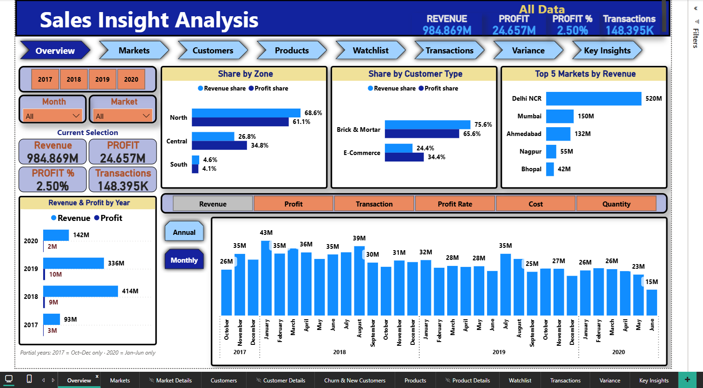
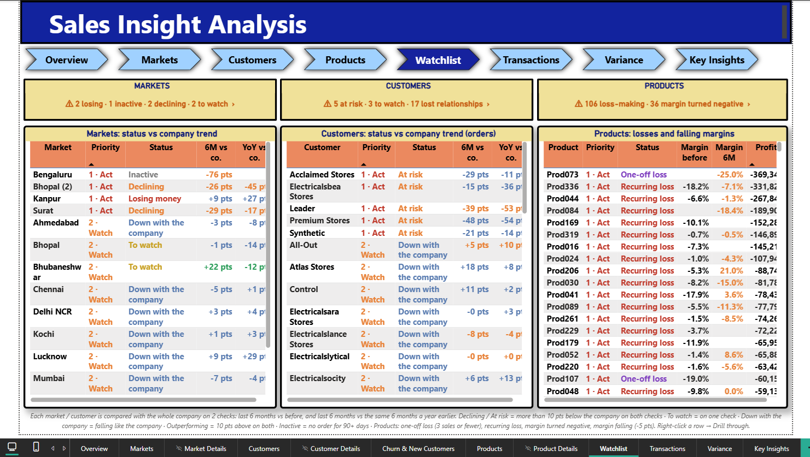
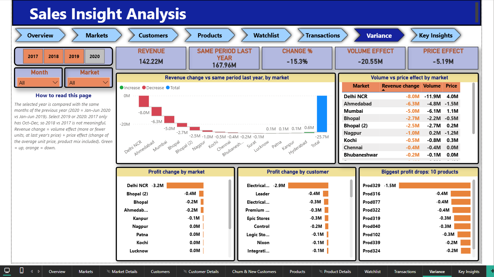
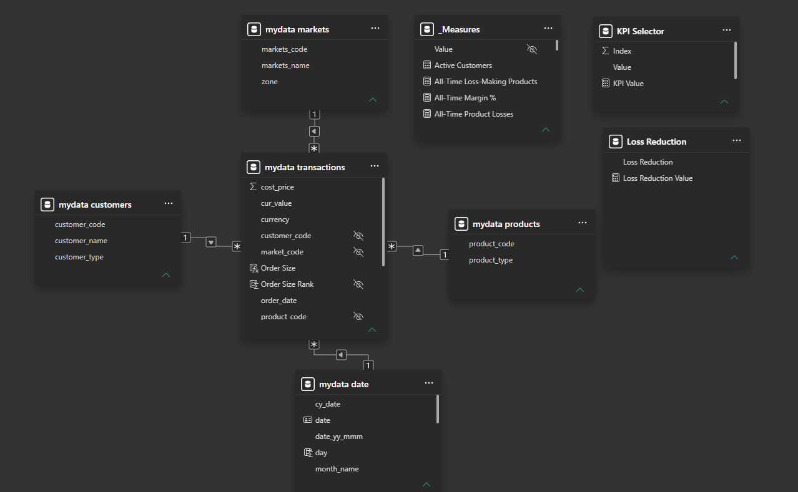

# Sales Insight Analysis – Power BI

An end-to-end sales analysis for a hardware distributor (AtliQ Hardware dataset, India, Oct 2017 – Jun 2020): **148,395 sales lines, 15 markets, 38 customers, 339 products**.

The report does not stop at "how much did we sell". It answers three business questions:

1. **Why is revenue falling?** It is volume, not price.
2. **Where are the risks?** Markets, customers and products are flagged automatically in a Watchlist.
3. **What should we do, and what is it worth?** Recommendations, a what-if scenario and a one-page decision memo.



---

## Key findings

| # | Finding | Evidence |
|---|---|---|
| 1 | **Revenue falls because we sell fewer units, not cheaper.** Jan–Jun 2020: −15.3% vs Jan–Jun 2019. | Volume effect −20.6M, price effect −5.2M; average unit price stable (≈406–421) |
| 2 | **The decline started before Covid-19.** | Jan–Jun 2019 was already −23% vs 2018 |
| 3 | **The margin is very thin, and losses are everywhere.** | 2.5% margin; 46% of sales lines sold at a loss in every market, channel and year |
| 4 | **The business depends on very few players.** | Delhi NCR = 52.8% of revenue; one customer = 42%; 13 of 38 customers = 80% |
| 5 | **Some markets need action.** | Bengaluru inactive since Oct 2018; Kanpur loses money; Surat and Bhopal (2) decline faster than the company |
| 6 | **E-Commerce earns more but falls faster.** | 24% of revenue, 34% of profit; −37% in the last 6 months vs −20% for stores |

**What-if:** sales made at a loss cost **81.3M**, more than 3× the total profit (24.7M). Removing only 30% of these losses would **double the profit**.

---

## Report pages

| Page | Purpose |
|---|---|
| **Overview** | KPIs (all data vs current selection), monthly trend with a KPI selector, zone and channel shares |
| **Markets** | Market ranking coloured by margin, revenue vs margin scatter (log scale), market scorecard |
| **Customers** | Customer ranking, Pareto concentration, customer scorecard |
| **Churn & New Customers** | Lost and new customer-market relationships, order trend per customer |
| **Products** | Product ranking, Pareto, product scorecard |
| **Watchlist** | Automatic status and priority for every market, customer and product (see rules below) |
| **Transactions** | Average ticket, order-size distribution, weekday pattern (B2B profile) |
| **Variance** | Same-period year-over-year comparison, waterfall by market, **price vs volume decomposition** |
| **Key Insights** | Findings, recommendations, what-if scenario and data notes |
| *Market / Customer / Product Details* | Drill-through pages with a **Health check** (status, trend vs company, margin before / last 6 months, full monthly history) |




---

## How the statuses work

Each market and customer is compared **with the whole company**, on two checks:

- the last 6 months vs the average month before, and
- the last 6 months vs the same 6 months one year earlier.

| Priority | Status | Rule |
|---|---|---|
| 1 · Act | Inactive / Losing money / Declining (At risk) | No order for 90+ days / negative margin / more than 10 pts below the company on **both** checks |
| 2 · Watch | To watch / Down with the company | More than 10 pts below on **one** check / falling at the company's pace |
| 3 · OK | Outperforming / Stable | More than 10 pts above on both checks / no clear move |

Products: one-off loss (3 sales or fewer), recurring loss, margin turned negative, margin falling (−5 pts).

Comparing with the company avoids a classic trap: when the whole business falls by 24%, a market at −27% is not really "declining".

---

## Data model and technique

- **Star schema:** one fact table (transactions) and four dimensions (date, markets, customers, products), plus a disconnected KPI selector and a what-if table.
- **Power Query:** CSV sources with a `DataFolder` parameter (no database needed), USD → INR conversion, data-quality fixes (product code case, missing product types → "Unknown", duplicated market name).
- **Date table** marked as a date table, custom `Calendar` hierarchy, auto date/time disabled.
- **DAX:** about 135 measures in 10 display folders: time intelligence (same period last year), price / volume effects, Pareto, churn, trend vs company, statuses, what-if.
- **Drill-through** pages, page navigation, bookmarks, conditional formatting driven by measures.
- Saved as a **Power BI Project (.pbip)**, so the model (TMDL) and the report (PBIR) are plain text and versioned in Git.



---

## Data limits (and how they are handled)

- **Partial years:** 2017 = Oct–Dec only, 2020 = Jan–Jun only → years are always compared on the same months.
- **Margins look random:** the margin of each sale is spread evenly between −35% and +40%, with no link to price, order size, market, channel or year. Loss analysis by product is therefore only used as a **targeting tool**, and the main recommendation is to audit deal pricing and cost data.
- **60 products have no type** (48% of revenue) → shown as "Unknown".
- **Two markets are named Bhopal** → Mark013 is shown as "Bhopal (2)".
- Some causes cannot be checked from the data (e.g. is Bengaluru closed or dormant?). They are listed as **questions to confirm with the business** in the decision memo.

---

## How to open the project

1. Download or clone this repository and copy the `Sales_PBIP` folder to `C:\` (the default data path is `C:\Sales_PBIP\data\`).
2. Open `sales.pbip` with **Power BI Desktop**.
3. If you put the folder elsewhere: *Transform data → Manage parameters → DataFolder* (end the path with `\`), then **Refresh**.

## Repository content

```
Sales_PBIP/
├── sales.pbip                      # open this file
├── sales.SemanticModel/            # data model (TMDL): tables, measures, Power Query
├── sales.Report/                   # report pages and visuals (PBIR)
├── data/                           # CSV sources
├── docs/Decision_Memo.pdf          # one-page decision memo
└── images/                         # screenshots used in this README
```

---

**Author:** Ghanmi Riadh – Data Analyst (Python · SQL · Power BI · Streamlit)
