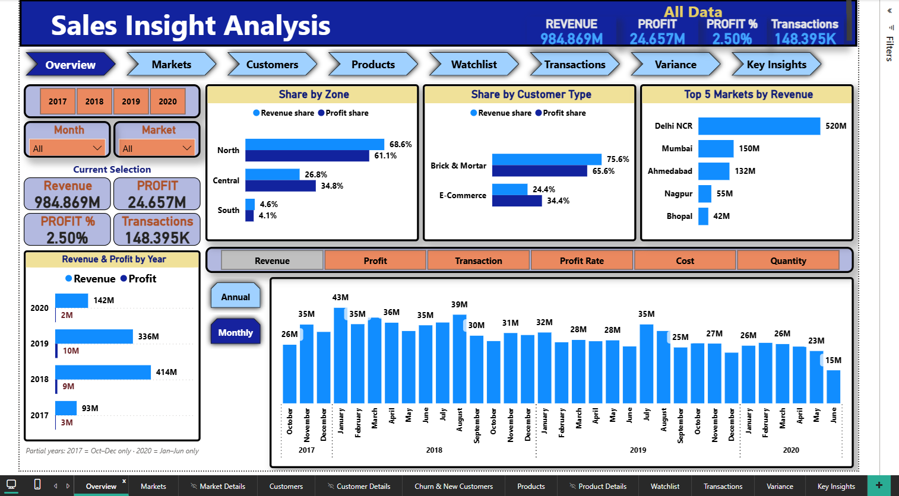
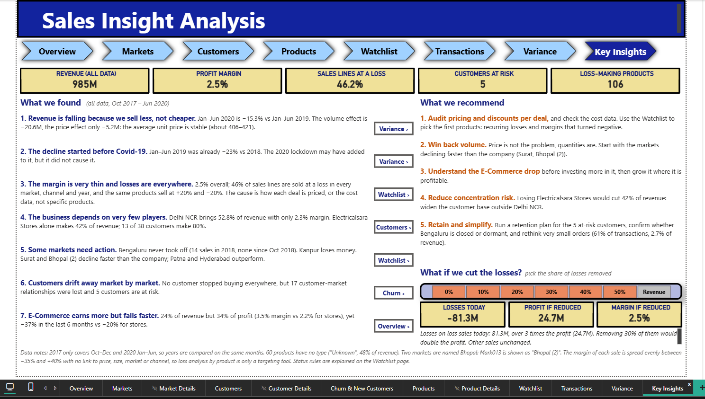
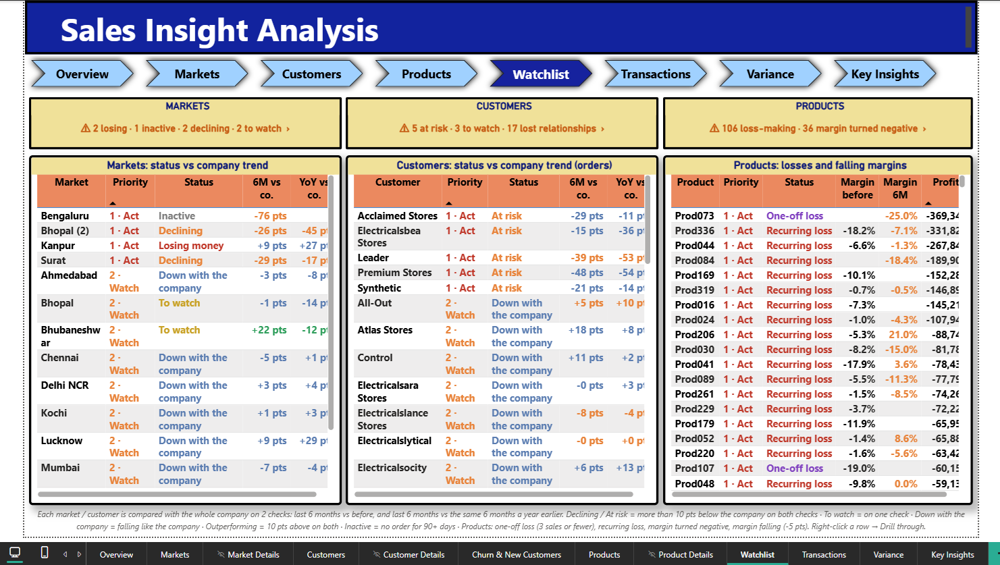
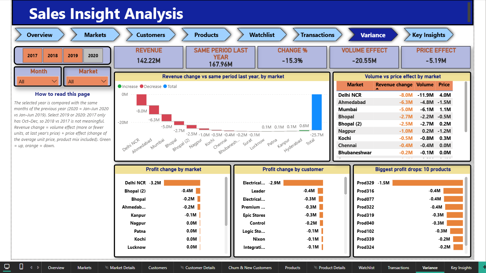
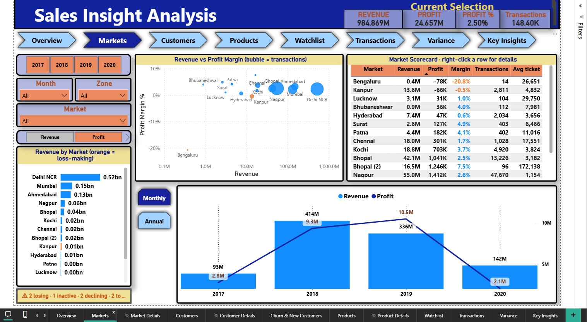
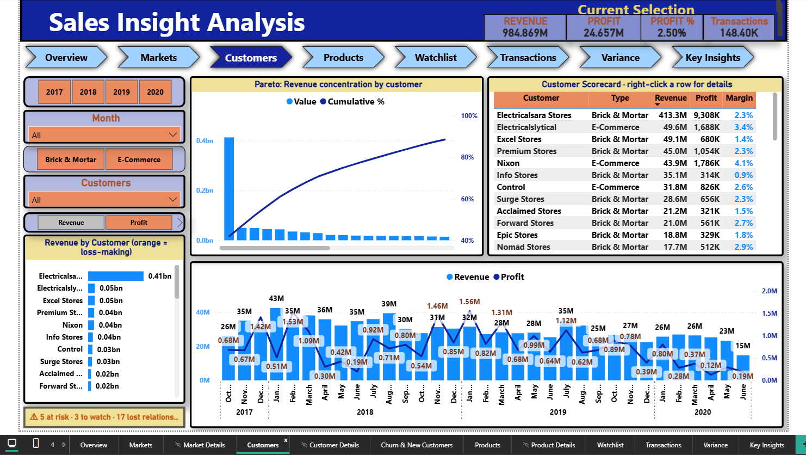
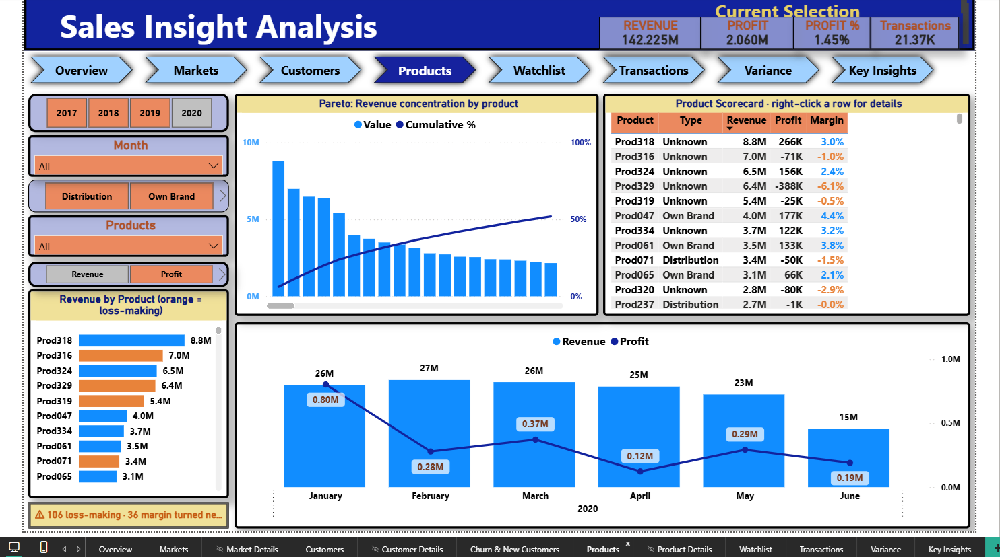
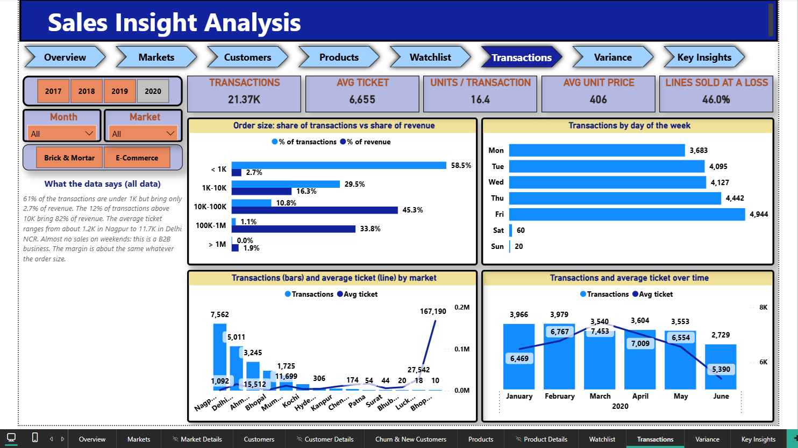
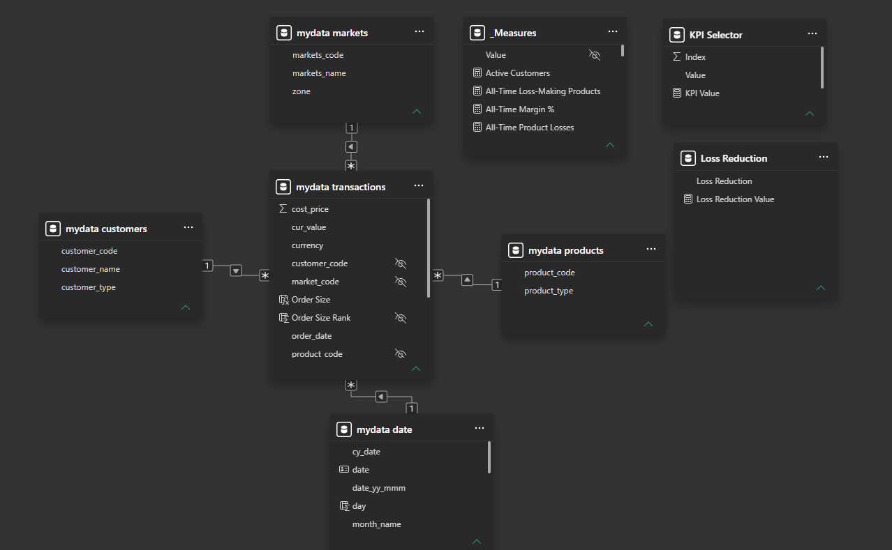

# Sales Insight Analysis – Power BI

Une analyse des ventes de bout en bout pour un distributeur de matériel informatique (jeu de données AtliQ Hardware, Inde, octobre 2017 – juin 2020) : **148 395 lignes de vente, 15 marchés, 38 clients, 339 produits**.

Le rapport ne s'arrête pas à « combien a-t-on vendu ». Il répond à trois questions métier :

1. **Pourquoi le chiffre d'affaires baisse-t-il ?** À cause des volumes, pas des prix.
2. **Où sont les risques ?** Marchés, clients et produits sont signalés automatiquement dans une Watchlist.
3. **Que faut-il faire, et combien cela vaut-il ?** Des recommandations, un scénario what-if et une note de décision d'une page.



---

## Constats clés

| # | Constat | Preuve |
|---|---|---|
| 1 | **Le CA baisse parce qu'on vend moins d'unités, pas moins cher.** Janvier–juin 2020 : −15,3 % par rapport à janvier–juin 2019. | Effet volume −20,6M, effet prix −5,2M ; prix unitaire moyen stable (≈ 406–421) |
| 2 | **La baisse a commencé avant le Covid-19.** | Janvier–juin 2019 était déjà à −23 % par rapport à 2018 |
| 3 | **La marge est très faible, et les pertes sont partout.** | 2,5 % de marge ; 46 % des lignes de vente sont à perte, dans chaque marché, canal et année |
| 4 | **L'activité dépend de très peu d'acteurs.** | Delhi NCR = 52,8 % du CA ; un seul client = 42 % ; 13 clients sur 38 = 80 % |
| 5 | **Certains marchés demandent une action.** | Bengaluru inactif depuis octobre 2018 ; Kanpur perd de l'argent ; Surat et Bhopal (2) baissent plus vite que l'entreprise |
| 6 | **L'E-Commerce rapporte plus, mais chute plus vite.** | 24 % du CA, 34 % du profit ; −37 % sur les 6 derniers mois contre −20 % pour les magasins |

**What-if :** les ventes réalisées à perte coûtent **81,3M**, soit plus de 3 fois le profit total (24,7M). Supprimer seulement 30 % de ces pertes **doublerait le profit**.



---

## Pages du rapport

| Page | Rôle |
|---|---|
| **Overview** | KPI (toutes les données et sélection en cours), évolution mensuelle avec choix du KPI, parts par zone et par canal |
| **Markets** | Classement des marchés coloré selon la marge, nuage CA × marge (échelle logarithmique), tableau de bord des marchés |
| **Customers** | Classement des clients, concentration (Pareto), tableau de bord des clients |
| **Churn & New Customers** | Relations client-marché perdues et nouvelles, tendance des commandes par client |
| **Products** | Classement des produits, Pareto, tableau de bord des produits |
| **Watchlist** | Statut et priorité automatiques pour chaque marché, client et produit (voir les règles ci-dessous) |
| **Transactions** | Panier moyen, répartition par taille de commande, ventes par jour de la semaine (profil B2B) |
| **Variance** | Comparaison sur la même période de l'année précédente, cascade par marché, **décomposition prix / volume** |
| **Key Insights** | Constats, recommandations, scénario what-if et notes sur les données |
| *Market / Customer / Product Details* | Pages de drillthrough avec un **Health check** (statut, tendance par rapport à l'entreprise, marge avant / sur les 6 derniers mois, historique mensuel complet) |




<details><summary><b>Autres captures</b></summary>







</details>

---

## Comment fonctionnent les statuts

Chaque marché et chaque client est comparé **à l'ensemble de l'entreprise**, selon deux critères :

- les 6 derniers mois comparés au mois moyen d'avant ;
- les 6 derniers mois comparés aux mêmes 6 mois un an plus tôt.

| Priorité | Statut | Règle |
|---|---|---|
| 1 · Act | Inactive / Losing money / Declining (At risk) | Aucune commande depuis 90 jours ou plus / marge négative / plus de 10 pts sous l'entreprise sur **les deux** critères |
| 2 · Watch | To watch / Down with the company | Plus de 10 pts sous l'entreprise sur **un seul** critère / en baisse au même rythme que l'entreprise |
| 3 · OK | Outperforming / Stable | Plus de 10 pts au-dessus sur les deux critères / pas de mouvement net |

Produits : perte ponctuelle (3 ventes ou moins), perte récurrente, marge passée en négatif, marge en baisse (−5 pts).

Comparer à l'entreprise évite un piège classique : quand toute l'activité baisse de 24 %, un marché à −27 % n'est pas vraiment « en déclin ».

---

## Modèle de données et technique

- **Modèle en étoile :** une table de faits (transactions) et quatre dimensions (dates, marchés, clients, produits), plus une table de sélection du KPI et une table what-if, non reliées.
- **Power Query :** sources CSV lues depuis GitHub ou un dossier local via un paramètre `DataFolder` (aucune base de données nécessaire), conversion USD → INR, corrections de qualité (casse d'un code produit, types de produits manquants → « Unknown », nom de marché en double).
- **Table de dates** marquée comme table de dates, hiérarchie `Calendar` personnalisée, date/heure automatique désactivée.
- **DAX :** environ 135 mesures en 10 dossiers : intelligence temporelle (même période l'année précédente), effets prix / volume, Pareto, churn, tendance par rapport à l'entreprise, statuts, what-if.
- Pages de **drillthrough**, navigation entre pages, signets, mise en forme conditionnelle pilotée par des mesures.
- Enregistré au format **Power BI Project (.pbip)** : le modèle (TMDL) et le rapport (PBIR) sont en texte et versionnés dans Git.



---

## Limites des données (et leur traitement)

- **Années partielles :** 2017 = octobre–décembre seulement, 2020 = janvier–juin seulement → les années sont toujours comparées sur les mêmes mois.
- **Des marges qui semblent aléatoires :** la marge de chaque vente est répartie uniformément entre −35 % et +40 %, sans lien avec le prix, la taille de la commande, le marché, le canal ou l'année. L'analyse des pertes par produit sert donc seulement à **cibler**, et la recommandation principale est d'auditer la tarification des ventes et les données de coût.
- **60 produits n'ont pas de type** (48 % du CA) → affichés « Unknown ».
- **Deux marchés s'appellent Bhopal** → Mark013 est affiché « Bhopal (2) ».
- Certaines causes ne peuvent pas être vérifiées avec les données (par exemple : Bengaluru est-il fermé ou en sommeil ?). Elles sont listées comme **questions à confirmer avec le métier** dans la note de décision.

---

## Comment ouvrir le projet

1. Clonez ou téléchargez ce dépôt, **dans n'importe quel dossier**.
2. Ouvrez `sales.pbip` avec **Power BI Desktop** : le rapport s'affiche directement avec ses données (le cache du modèle est inclus).
3. **Actualiser** relit les CSV depuis ce dépôt GitHub (connexion internet nécessaire ; à la première actualisation, choisissez l'accès *Anonyme*).
4. Pour travailler hors ligne : *Transformer les données → Modifier les paramètres → DataFolder*, indiquez le chemin complet du dossier `data` (terminé par `\`), puis **Actualiser**.

## Contenu du dépôt

```
Sales_PBIP/
├── sales.pbip                      # le fichier à ouvrir
├── sales.SemanticModel/            # modèle de données (TMDL) : tables, mesures, Power Query
├── sales.Report/                   # pages et visuels du rapport (PBIR)
├── data/                           # sources CSV
├── docs/Decision_Memo.pdf          # note de décision d'une page
└── images/                         # captures d'écran utilisées dans ce README
```

---

**Auteur :** Ghanmi Riadh – Data Analyst (Python · SQL · Power BI · Streamlit)
